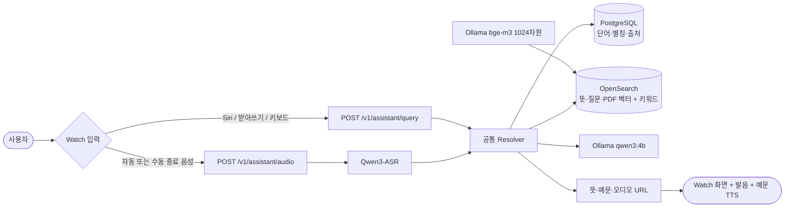

# TalkieVoca

> Apple Watch에 단어를 말하면 한국어 뜻과 쉬운 영어 예문을 찾고, 단어 발음과 예문을 손목에서 바로 들려주는 개인 영어 학습 제품.

[전체 아키텍처를 한눈에 보기](docs/architecture.html) · [현재 상태](CURRENT.md) · [실행 가이드](RUNBOOK.md) · [설계 결정](DECISIONS/)

## Product North Star

TalkieVoca의 핵심은 화면을 오래 조작하지 않는 것이다. 사용자는 손목을 들고 한국어나 영어 단어 하나를 말한 뒤, 다음 결과를 짧은 흐름 안에서 받아야 한다.

1. Apple Watch에서 Siri/App Intent 또는 앱의 받아쓰기로 단어를 입력한다.
2. 앱의 `음성으로 찾기`는 원본 음성을 Qwen3-ASR에 보내고, 짧은 침묵 또는 완료 탭에서 녹음을 끝낸다.
3. 백엔드는 저장된 단어, RAG 문서, 로컬 SLM 순서로 답을 찾는다.
4. Watch는 한국어 뜻과 한·영 예문을 보여준다.
5. 등록된 단어 음원을 재생하고, 음원이 없으면 watchOS TTS로 단어와 예문을 읽는다.

발음 채점, 상시 마이크, 대화형 챗봇은 현재 제품 범위가 아니다.



## Current Status

| 영역 | 상태 | 확인된 내용 |
|---|---|---|
| Watch 입력 | PoC 완료 | 실물 Watch에서 받아쓰기와 텍스트 API 호출 확인 |
| 통합 API | 구현·테스트 완료 | 텍스트와 음성이 하나의 resolver를 사용 |
| 지식/미디어 | 관리자 업로드 검증 완료 | 실제 PDF·MP3 폼 업로드, PDF 단어 추출, MP3 브라우저 디코딩 |
| 의미 검색 | 초기 통합 검증 완료 | bge-m3 1024차원, 뜻·예문·질문/PDF 임베딩, paraphrase → squid 확인 |
| SLM fallback | 구현·테스트 완료 | 없는 단어를 Ollama가 생성하고 `slm/pending`으로 재사용 |
| Qwen3-ASR | 로컬 API E2E 완료 | 영어 `apple`과 한국어 `사과` 음성 모두 Qwen → resolver → 발음 URL 확인 |
| 단어 검수 | 구현·테스트 완료 | `/admin/`에서 pending 수정·승인·제외, trusted 인덱싱 확인 |
| 실물 Watch Qwen E2E | 검증 대기 | 실제 ASR endpoint에서 녹음 → 응답 → 재생 확인 필요 |
| Siri App Intent | 조건부 | App Intent metadata 빌드 완료, 실제 Siri entitlement는 유료 Apple Developer Team 필요 |

세부 사실과 다음 한 가지 행동은 [CURRENT.md](CURRENT.md)를 기준으로 한다.

## Repository Map

TalkieVoca는 제품 코드와 운영 기억을 독립 저장소로 관리한다.

```text
TalkieVoca/
  _control/              # 제품 헌법, ADR, 작업 계약, 현재 상태, 아키텍처 문서
  talkievoca-apple/      # SwiftUI + App Intents 기반 iOS/watchOS 클라이언트
  talkievoca-backend/    # Kotlin + Spring Boot + AI/RAG/미디어 API
  .worktrees/            # Orca 에이전트 작업 공간, Git 추적 금지
```

| 저장소 | 책임 | 책임지지 않는 것 |
|---|---|---|
| [talkievoca-apple](https://github.com/sp-daewoon/talkievoca-apple) | 입력 UX, App Intent, HTTP 호출, 화면, 햅틱, 음원/TTS 재생 | API key, RAG 판단, AI provider 선택 |
| [talkievoca-backend](https://github.com/sp-daewoon/talkievoca-backend) | API 계약, 단어 해석, 출처 관리, RAG, ASR/SLM 연결, 미디어 제공 | Watch UI와 사용자 입력 방식 |
| [talkievoca-control](https://github.com/sp-daewoon/talkievoca-control) | 프로젝트 규칙, 현재 상태, ADR, 작업 명세, 문서 | 제품 런타임 코드 |

`ragBaseSample`은 학습용 샘플이며 TalkieVoca의 코드, 의존성, 배포 경로가 아니다.

## Runtime Architecture

### Fast path

`Siri/App Intent 또는 Watch 받아쓰기 → POST /v1/assistant/query → resolver → 화면/재생`

이미 텍스트가 만들어졌으므로 Qwen3-ASR을 호출하지 않는다. 저장된 단어는 모델 호출 없이 가장 빠르게 반환한다.

### High-accuracy fallback

`음성으로 찾기 → 자동/수동 종료 M4A → POST /v1/assistant/audio → Qwen3-ASR → 같은 resolver`

Siri가 소비한 원본 음성은 앱이 다시 얻을 수 없다. 따라서 Qwen은 별도의 명시적 녹음 경로에서만 동작한다. Watch의 임시 녹음은 요청 후 삭제하며 백엔드도 원본 음성을 저장하지 않는다.

### Resolution order

1. PostgreSQL의 정확한 영단어와 한국어/영어 별칭을 조회한다.
2. 일치하지 않으면 bge-m3로 질문을 임베딩해 승인 단어의 뜻·예문·질문과 PDF 본문에서 의미 후보 최대 3개를 찾고, PDF 키워드 검색을 병행한다.
3. Ollama `qwen3:4b`가 문맥을 참고해 단어 카드를 생성한다.
4. 생성 결과는 PostgreSQL에 `origin=slm`, `verification_status=pending`으로 캐시한다.
5. `pending` 데이터는 재조회에 사용할 수 있지만 검수 전에는 신뢰 RAG 인덱스에 넣지 않는다.
6. 운영자가 `/admin/`에서 수정 승인하면 `manual/trusted`로 바뀌고 별칭·질문과 OpenSearch 문서가 교체된다. 검색 결과는 최신 PostgreSQL 데이터와 대조해 오래된 결과를 제외한다.

영단어만 벡터화하지 않는다. 한국어 뜻, 한·영 예문, 검수된 질문 표현을 하나의 문서로 구성한다. 모델과 차원을 고정한 `talkievoca-meaning-bge-m3-v1` 인덱스에서 cosine 검색하며 유사도는 정답 확률이 아니다. pgvector 확장이 가능한 DB 이미지를 쓰지만 실제 벡터 저장소는 OpenSearch 하나다.

## Operator Workflow

`/admin/` → **자료 · 음원** → PDF 업로드 → 목록의 **단어 추출** → **단어 검수**에서 뜻·예문·질문 승인 → 단어에 MP3 연결·미리듣기.

신규 단어는 수동 등록도 가능하다. PDF 추출은 앞 12,000자에서 최대 20개를 제안하고 신규 카드만 `pending`으로 저장한다. 기존 단어는 보존하며 PDF 출처 연결을 남긴다. 전체 PDF의 검색용 chunk는 별도로 생성한다. 스캔 PDF OCR과 대용량 비동기 추출은 아직 지원하지 않는다. MP3는 단어 발음 자산이며 벡터화하지 않고 예문은 Watch TTS를 유지한다.

**의미 검색 확인**에서 후보 본문/유사도를 확인하고 **임베딩 다시 생성**에서 성공·실패 개수를 확인한다. 임베딩 실패는 DB 저장을 취소하지 않으므로 복구 후 재생성해야 한다. 상세 설정과 검증 한계는 backend README를 따른다.

자세한 흐름과 배포 토폴로지는 [아키텍처 문서](docs/architecture.html)에 정리돼 있다.

## Data Ownership

| 데이터 | 저장 위치 | 정책 |
|---|---|---|
| 단어, 뜻, 예문, 별칭, 질문, 출처 연결, 검증 상태 | PostgreSQL | 제품 데이터의 source of truth |
| PDF 원본과 업로드 음원 | Docker `media_data` volume | Git에 커밋하지 않음 |
| 뜻·질문·PDF의 1024차원 벡터와 키워드 인덱스 | OpenSearch | 재생성 가능한 retrieval index |
| SLM 생성 단어 | PostgreSQL | `pending`으로 저장 후 검수 전 신뢰 인덱스 제외 |
| Watch 사용자 녹음 | 저장 안 함 | ASR 요청 동안만 존재하고 즉시 폐기 |
| 인증 정보/API key | 로컬 환경 변수 | 앱과 Git에 넣지 않음 |

`docker compose down`은 데이터를 보존하고, `docker compose down -v`는 PostgreSQL·OpenSearch·미디어·모델 캐시 volume을 삭제한다.

## API Surface

| Method | Path | 용도 |
|---|---|---|
| `GET` | `/health` | API, ASR, SLM 준비 상태 |
| `POST` | `/v1/assistant/query` | Siri, 받아쓰기, 키보드 텍스트의 기본 진입점 |
| `POST` | `/v1/assistant/audio` | 명시적 Watch 녹음을 Qwen3-ASR로 인식 |
| `GET` | `/v1/admin/vocabulary` | pending/trusted 단어 검수 목록 |
| `POST` | `/v1/admin/vocabulary/corrections` | 단어·예문·별칭 수정 승인 |
| `POST` | `/v1/knowledge/pdf` | PDF 저장, text chunk 생성, OpenSearch 인덱싱 |
| `GET` | `/v1/knowledge/sources` | 업로드 자료 목록 |
| `POST` | `/v1/knowledge/{sourceId}/vocabulary` | PDF에서 검수 대기 단어 취합 |
| `GET` | `/v1/admin/vocabulary/search?q=` | 의미 후보와 cosine 확인 |
| `POST` | `/v1/admin/vocabulary/reindex` | 뜻·질문·PDF 벡터 재생성 |
| `GET` | `/v1/knowledge/search?q=` | 운영 확인용 문서 검색 |
| `POST` | `/v1/media/audio?word=` | 단어 발음 음원 등록/교체 |
| `GET` | `/v1/media/{mediaId}` | Watch용 음원 스트리밍 |
| `GET` | `/v1/watch/word-feedback` | 이전 호환 및 진단용 endpoint |

대표 응답:

```json
{
  "query": "사과",
  "word": "apple",
  "meaning_ko": "사과",
  "example_en": "I ate an apple.",
  "example_ko": "나는 사과를 먹었다.",
  "audio_url": "http://192.168.x.x:8080/v1/media/…",
  "matched_by": "alias",
  "source": "seed",
  "verified": true,
  "transcript_language": null
}
```

## Local Start

### 1. Backend

```bash
cd talkievoca-backend
brew services start ollama
ollama pull qwen3:4b
ollama pull bge-m3
docker compose up --build
curl http://localhost:8080/health
```

백엔드 상세 설정, 업로드 예시, Qwen 연결 방법은 [talkievoca-backend README](https://github.com/sp-daewoon/talkievoca-backend)를 따른다.

### 2. Physical Apple Watch

1. Xcode에서 `talkievoca-apple/TalkieVoca.xcodeproj`를 연다.
2. `TalkieVoca` scheme과 페어링된 실물 Apple Watch를 선택한다.
3. 앱 설정의 API 주소를 Mac의 LAN 주소(예: `http://192.168.x.x:8080`)로 지정한다.
4. `연결 확인` 후 `사과`, `green`을 받아쓰기와 `정확히 듣기` 양쪽에서 확인한다.

실물 Watch에서 Mac의 `localhost`에는 접근할 수 없다. watchOS simulator의 받아쓰기는 실제 음성 인식 합격 환경으로 사용하지 않는다.

## Product Guardrails

- Apple 앱과 백엔드는 versioned HTTP 계약으로만 통신한다.
- 서버 비밀값과 provider 선택은 백엔드가 소유한다.
- 사용 횟수는 곧 신뢰도가 아니다. AI 생성 데이터는 자동으로 trusted가 되지 않으며 관리자 수정 승인을 거친다.
- 단어 음원은 미디어 자산이며 vector 문서가 아니다.
- 기능 완료는 빌드가 아니라 실물 Watch → API → 재생의 end-to-end 확인으로 판정한다.
- 되돌리기 어려운 제품·API·데이터 결정은 구현 전에 ADR로 남긴다.

## Control System

에이전트와 개발자는 다음 순서로 최소 컨텍스트만 읽는다.

1. [CURRENT.md](CURRENT.md)
2. [CONSTITUTION.md](CONSTITUTION.md)
3. 해당 [TASKS](TASKS/) 문서
4. 관련 [DECISIONS](DECISIONS/) 문서

작업이 끝나면 검증 사실과 다음 행동을 `CURRENT.md`에 반영한다. `_control` 규칙 또는 계약이 바뀌면 `CHANGELOG.md`에 남기고, 이미 승인된 ADR은 수정하지 않고 새 ADR로 대체한다.

```bash
cd _control
./scripts/verify-control.sh
```

## Roadmap

| 단계 | 목표 |
|---|---|
| Now | 업데이트된 실물 Watch 앱에서 자동 녹음 종료 → 발음/예문 재생 최종 확인 |
| Next | 관리자 인증, HTTPS, 운영 배포와 관측성 |
| Later | 사용자 계정/동기화, 구독 또는 광고, iOS/AOS 클라이언트 확장 |
